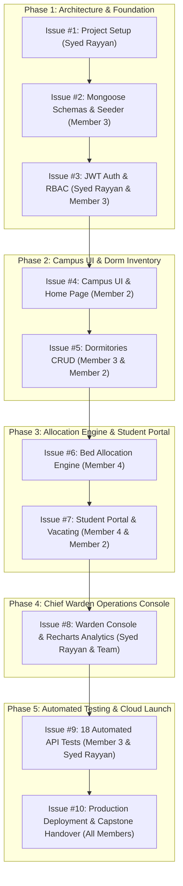

# XSHostel — Team Development Guide & Execution Blueprint

> **A Complete Master Roadmap for Syed Rayyan (Team Leader) and His 3 Team Members to Build, Review, and Deliver the XSHostel System**

---

## 1. Team Roster & Division of Labor

| Member | Designated Role | Primary Focus | Issues Assigned |
| :--- | :--- | :--- | :--- |
| **Syed Rayyan** | **Team Leader & Full-Stack Lead** | Architecture, security, JWT/RBAC, PR reviews, merge management, Warden console, and final deployment. | **#1**, **#3**, **#8**, **#10** |
| **Member 2** | **Frontend UI/UX Specialist** | CSS design system, responsive navigation, Home page, Dorm catalog filters, details gallery, and Recharts charts. | **#4**, **#5 (UI)**, **#7 (UI)**, **#8 (UI)** |
| **Member 3** | **Backend & Database Specialist** | MongoDB Mongoose schemas, Dorm CRUD REST APIs, database seeder, error middleware, and 18-point automated test suite. | **#2**, **#5 (API)**, **#8 (API)**, **#9** |
| **Member 4** | **Hostel Allocation Specialist** | Bed allocation engine, overlap & overcapacity conflict prevention (`409 Conflict`), bursar fee calculation, and student portal. | **#6**, **#7 (Portal)** |

---

## 2. Chronological Sprint Execution Plan

To avoid merge conflicts and ensure zero bottlenecks, the team must execute in **5 sequential phases**:



---

## 3. How the 3 Members Work on Their Assigned Issues

### Guide for Member 2 (Frontend Specialist):
1. **Pull latest `main`:** `git checkout main && git pull origin main`
2. **Create feature branch:** `git checkout -b feature/public-ui`
3. **Open Issue Guide:** Read [`docs/issues/ISSUE_04_public_website_ui.md`](file:///Users/syedrayyan/.gemini/antigravity-ide/scratch/ryan/docs/issues/ISSUE_04_public_website_ui.md).
4. **Implement UI:**
   - Configure `--bg-primary: #0A0F1D` and styling tokens in `src/index.css`.
   - Build `Navbar.jsx` with mobile hamburger drawer and links to Blocks A, B, C.
   - Build `Home.jsx` with interactive search widget and amenities.
5. **Verify:** Check responsiveness across mobile and desktop at `http://localhost:5173`.
6. **Submit PR:** Commit changes, push to GitHub, and open Pull Request for **Syed Rayyan**.

---

### Guide for Member 3 (Backend Specialist):
1. **Pull latest `main`:** `git checkout main && git pull origin main`
2. **Create feature branch:** `git checkout -b feature/database-architecture`
3. **Open Issue Guide:** Read [`docs/issues/ISSUE_02_database_backend_architecture.md`](file:///Users/syedrayyan/.gemini/antigravity-ide/scratch/ryan/docs/issues/ISSUE_02_database_backend_architecture.md).
4. **Implement Schemas:**
   - Create `src/models/User.js`, `Room.js`, `Booking.js`, `Review.js`.
   - Configure seeder in `src/utils/seeder.js` with Blocks A, B, C dorms.
5. **Verify:** Run `npm run seed` and confirm MongoDB documents are populated cleanly.
6. **Submit PR:** Commit changes, push to GitHub, and open Pull Request for **Syed Rayyan**.

---

### Guide for Member 4 (Allocation & Full-Stack Specialist):
1. **Pull latest `main`:** `git checkout main && git pull origin main`
2. **Create feature branch:** `git checkout -b feature/booking-system`
3. **Open Issue Guide:** Read [`docs/issues/ISSUE_06_booking_system_availability.md`](file:///Users/syedrayyan/.gemini/antigravity-ide/scratch/ryan/docs/issues/ISSUE_06_booking_system_availability.md).
4. **Implement Logic:**
   - Write conflict detection query preventing date overlap and overcapacity (`409 Conflict`).
   - Implement bursar calculation: `baseSemesterFee + messFee + cautionDeposit`.
   - Build `BookingPage.jsx` with mess meal plan radio selector.
5. **Verify:** Attempt double booking and confirm HTTP 409 status code.
6. **Submit PR:** Commit changes, push to GitHub, and open Pull Request for **Syed Rayyan**.

---

### Guide for Syed Rayyan (Team Leader & Reviewer):
1. Review every Pull Request on GitHub:
   - Check code quality, security rules, and error handling.
   - Ensure no plaintext passwords or secrets are committed.
2. Run test verification locally:
   ```bash
   node backend/src/utils/testSuite.js
   cd frontend && npm run build
   ```
3. Merge approved PR into `main` and notify the team to rebase/pull.

---

## 4. GitHub Issue & Branch Cheatsheet

| Issue # | Topic | Branch Name | Owner | Command to Start |
| :---: | :--- | :--- | :--- | :--- |
| **#1** | Mono-repo Setup | `feature/project-setup` | Syed Rayyan | `git checkout -b feature/project-setup` |
| **#2** | Mongoose Schemas & Seeder | `feature/database-architecture` | Member 3 | `git checkout -b feature/database-architecture` |
| **#3** | JWT Auth & RBAC Security | `feature/authentication` | Syed Rayyan & M3 | `git checkout -b feature/authentication` |
| **#4** | Campus UI & Landing Page | `feature/public-ui` | Member 2 | `git checkout -b feature/public-ui` |
| **#5** | Dorms CRUD & Catalog | `feature/room-crud` | Member 3 & M2 | `git checkout -b feature/room-crud` |
| **#6** | Allocation Engine & Conflicts | `feature/booking-system` | Member 4 | `git checkout -b feature/booking-system` |
| **#7** | Student Portal & Vacating | `feature/profiles-reviews` | Member 4 & M2 | `git checkout -b feature/profiles-reviews` |
| **#8** | Warden Console & Recharts | `feature/admin-dashboard` | Syed Rayyan & Team | `git checkout -b feature/admin-dashboard` |
| **#9** | 18 Automated API Tests | `feature/testing-documentation` | Member 3 & Lead | `git checkout -b feature/testing-documentation` |
| **#10** | Cloud Deployment & Handover | `feature/collaboration-deployment` | Syed Rayyan & All | `git checkout -b feature/collaboration-deployment` |

---

## 5. Verification Commands for the Team

```bash
# 1. Run local MongoDB seeding
cd backend && npm run seed

# 2. Run automated test suite (must output 18 PASSED, 0 FAILED)
node src/utils/testSuite.js

# 3. Test frontend build
cd ../frontend && npm run build

# 4. Check API health
curl http://localhost:5000/api/health
```
