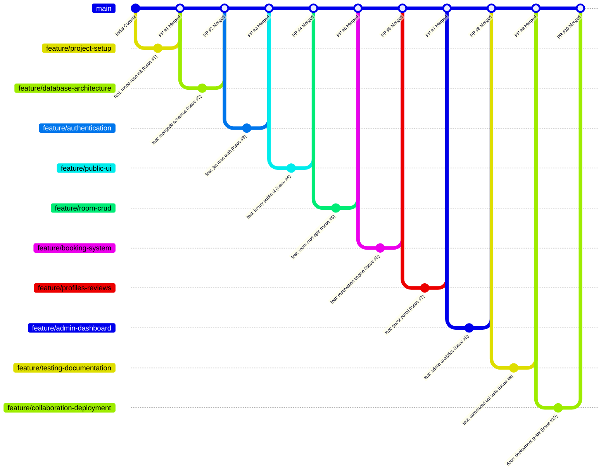

# XShotel — Four-Member Team Collaboration & Responsibility Matrix

## Project Title: XShotel (Complete Full-Stack Hotel Management System)
**Academic Term:** 2026 Academic Capstone  
**Repository:** [https://github.com/syedryaaan/ryan.git](https://github.com/syedryaaan/ryan.git)

---

## 1. Team Roster & Roles

| Member Name | Role | Primary Responsibilities |
| :--- | :--- | :--- |
| **Syed Rayyan** | **Team Leader & Full-Stack Security Lead** | Repository initialization, JWT/RBAC security, Admin dashboard integration, PR reviews, merge management, deployment coordination, and final submission. |
| **Member 2** | **Frontend Developer** | Global design system, responsive UI components, Home page, Suites catalog, Room details, and admin UI styling. |
| **Member 3** | **Backend Developer** | MongoDB Atlas integration, Mongoose data schemas, Room CRUD APIs, centralized error handling, and automated test suite. |
| **Member 4** | **Booking & Integration Developer** | Hotel reservation engine, date overlap prevention, server-side pricing, guest profiles, booking history, and review system. |

---

## 2. Issue & Pull Request Allocation Matrix

Each team member is assigned primary ownership of distinct issues and contributes as supporting reviewer/developer on secondary issues.

| Issue # | Issue Title | Primary Owner | Supporting | Feature Branch | Linked Pull Request |
| :---: | :--- | :--- | :--- | :--- | :--- |
| **#1** | Project Initialization & Environment Setup | **Syed Rayyan** | Member 2, Member 3 | `feature/project-setup` | PR #1: Initial mono-repo setup |
| **#2** | Database Setup & Backend Architecture | **Member 3** | Syed Rayyan | `feature/database-architecture` | PR #2: MongoDB Mongoose schemas |
| **#3** | Authentication & Role-Based Authorization | **Syed Rayyan** | Member 2 | `feature/authentication` | PR #3: JWT authentication & RBAC |
| **#4** | Premium Website UI & Public Pages | **Member 2** | Syed Rayyan | `feature/public-ui` | PR #4: Luxury frontend design system |
| **#5** | Complete Room Management CRUD | **Member 3** | Member 2 | `feature/room-crud` | PR #5: Room CRUD endpoints & modals |
| **#6** | Booking System & Availability Engine | **Member 4** | Member 3 | `feature/booking-system` | PR #6: Reservation engine & pricing |
| **#7** | User Profiles, History & Reviews | **Member 4** | Member 2 | `feature/profiles-reviews` | PR #7: Guest portal & review flow |
| **#8** | Admin Dashboard & Analytics | **Syed Rayyan** | Member 2, Member 4 | `feature/admin-dashboard` | PR #8: Recharts & operations ledger |
| **#9** | Automated Testing & Complete Documentation | **Member 3** | Syed Rayyan | `feature/testing-documentation` | PR #9: 18-point test suite & docs |
| **#10** | GitHub Collaboration & Cloud Deployment | **Syed Rayyan** | All Members | `feature/collaboration-deployment` | PR #10: Production Vercel/Render build |

---

## 3. GitHub Workflow & Pull Request Process

### Collaboration Rules:
1. **No direct pushes to `main`**: All features are engineered on dedicated `feature/<name>` branches.
2. **Issue Linking**: Commit messages and Pull Requests reference the target issue (e.g. `feat: implement booking overlap query (Closes #6)`).
3. **Peer Review**: Before any PR is merged into `main`, the Team Leader reviews functionality, security, and test verification.
4. **Clean Builds**: Production builds (`npm run build` and `node src/utils/testSuite.js`) must pass 100% prior to closing issues.
